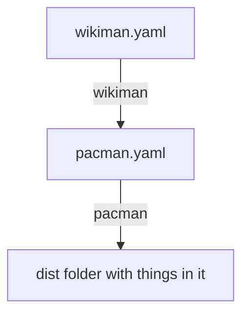

## Build scripts

### Overview


### Checklist for updating MediaWiki

- In `wikiman.yaml`:
  - Check that `mediawikiVersion` is still the version we want to target.
  - If `mediawikiRepoRef` is set, check that the reason for pinning it is still valid. Remove it if it is not.
- Run `./sync/wikiman/wikiman .` and review each configured patch when prompted.
  - Check whether the patch has been merged upstream or is no longer required.
  - If it is no longer required, remove it from `wikiman.yaml` and rerun `wikiman`.
  - Otherwise, keep it or update it so that it applies to the updated code.
- Run `./bin/verify-wikiman-pacman-patches.sh` to check that the patch URLs in `wikiman.yaml` and `pacman.yaml` match.
- Run `./sync.sh`.

### sync.sh

This script will resync the `dist` directory.

This is made up of a series of steps:

- Empty the `dist` directory entirely
- `pacman`: Retrieve and build MediaWiki code, remove any bloat files that are not needed
- `sync_dist-persist.sh`: Sync the `dist-persist` directory into `dist` (Custom & extra wbstack hooks, config, and files)
- `04-docker-compose`: Perform a composer install
- `05-docker-entrypoint-overrides`: Add the WBStack shims to MediaWiki entrypoints

Assuming neither `dist-persist` directory or `pacman.yaml` have changed then running this script should almost be a no-op. The only files we expect to change are composer autoload files and composer's own vendor folder.

There is a GitHub Action [Workflow](../.github/workflows/wbstack.sync.check.yml) running to attempt to ensure that `sync.sh` has been run on every commit so that the dist directory does not get out of sync from what it is built from.

### wikiman & pacman
#### wikiman
> usage: `./sync/wikiman/wikiman .`

`wikiman` is a MediaWiki specific yaml generator for pacman.
This needs to be run by developers when updating component versions in `wikiman.yaml`

By default, `wikiman` prompts for each configured patch before copying it to `pacman.yaml`. Use `--patches keep` to keep every patch without prompting, or `--patches drop` to drop every patch without prompting.

> [!NOTE]
> In order to be able to run wikiman you need to create a GitHub token in a file called `/sync/.github`.
> The token does not require any special permissions, and it does not matter if it's a `classic` or `fine-grained token (beta)` token.
> You can generate a new token [here](https://github.com/settings/personal-access-tokens).

#### pacman
`pacman` is a generic tool using yaml to fetch a series of codebases and place them on disk.
This is run as a step in `sync.sh`

#### Syncing patches

To apply additional Gerrit patches, add them to the corresponding component in `wikiman.yaml`.

Example:
```yaml
- name: WikibaseCirrusSearch
  repoName: wikimedia/mediawiki-extensions-WikibaseCirrusSearch
  patches:
    - url: https://gerrit.wikimedia.org/r/changes/mediawiki%2Fextensions%2FWikibaseCirrusSearch~1120939/revisions/2/patch?download
```

`wikiman` copies retained patches to `patchUrls` in `pacman.yaml`. Do not edit generated `patchUrls` directly because the next `wikiman` run will replace them.
